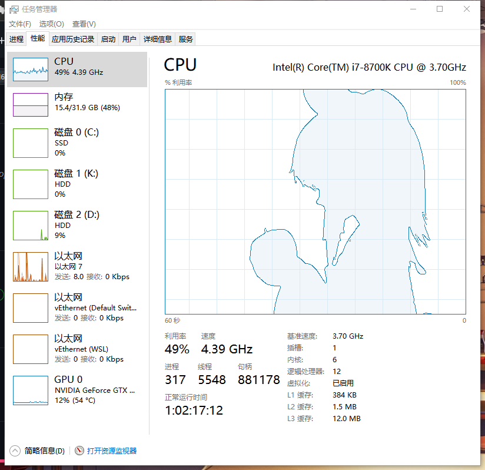

# TaskmgrPlayer

在 Windows 任务管理器的 **CPU 性能图**上播放视频。支持单核大图，也支持“逻辑处理器”多核小图网格；在 Windows 11 上可以正常工作。

> **参考项目**：本项目参考并修改自 [**svr2kos2/TaskmgrPlayer**](https://github.com/svr2kos2/TaskmgrPlayer)。
> 原项目提供了“把视频画到任务管理器 CPU 图表上”的核心思路和初始实现；本仓库在此基础上修复了
> Windows 11 兼容性问题、增加了多核视图同时播放，并改为单窗口合成渲染以降低开销。
> 原项目与本仓库均使用 **GPL-3.0**，详见 [LICENSE](./LICENSE)。

## 功能

- **Windows 11 可用**：不再使用跨进程 `SetParent`，视频是一个独立的置顶、无边框、鼠标穿透的覆盖窗口，每帧跟随任务管理器中的 CPU 图表。
- **多核同时播放**：自动识别当前可见的所有逻辑处理器小图，每个小图都同时播放同一段视频，而不是只覆盖其中一个。
- **单核/多核自动切换**：在任务管理器里切换图表类型后，程序会在 0.5 秒内重新识别布局。
- **低开销**：只解码一次视频；所有小图合成到一张画布，只创建一个覆盖窗口、只调用一次 `imshow`；相同尺寸的小图复用处理结果。
- **高 DPI 适配**：支持 Per-Monitor DPI，缩放不是 100% 时也不会偏移。
- **音频**：优先播放同目录的 `audio.wav`，没有时再用 `ffmpeg` 从视频提取音轨。
- **鼠标穿透**：点击会落到任务管理器上；任务管理器打开右键菜单时覆盖窗口临时隐藏，因此播放中也能切换单核/多核视图。

## 和原版的主要区别

| 项目 | 原版 | 本版 |
| --- | --- | --- |
| Windows 11 | 依赖跨进程 `SetParent`，可能把视频丢到桌面 | 独立置顶覆盖窗口，不依赖 `SetParent`，不需要管理员权限 |
| 多核视图 | 只覆盖一个图表 | 所有逻辑处理器小图同时播放 |
| 图表识别 | 不检查可见性，可能选到隐藏图表 | 只枚举当前可见的 `CvChartWindow`，支持多个父容器 |
| 渲染方式 | 每个图表一个窗口 | 单窗口合成画布，空隙用颜色键透明 |
| 音频 | 依赖临时文件 / 外部命令 | 优先 `audio.wav`，否则 `ffmpeg` 提取到 `%TEMP%`，退出清理 |
| 构建 | 手动改 OpenCV 路径 | `build.bat` 自动查找 VS / OpenCV，参数化 vcxproj |

## 快速开始

### 方式一：一键编译（推荐）

1. 安装 Visual Studio 2019 或 2022（勾选“使用 C++ 的桌面开发”）。
2. 安装 OpenCV Windows 版（4.x / 5.x 均可），例如解压到 `C:\opencv`。
3. 双击仓库根目录的 `build.bat`。
4. 编译产物在 `dist\Release\`，直接运行里面的 `TaskmgrPlayer.exe`。

`build.bat` 会：

1. 用 `vswhere` 自动查找 Visual Studio / MSBuild；
2. 自动查找 OpenCV（`C:\opencv`、`C:\Program Files\OpenCV\opencv` 等），找不到时提示输入；
3. 编译 `Release | x64`；
4. 把 exe、OpenCV 运行库、`config.cfg`、`audio.wav`、示例视频复制到 `dist\Release`。

可选参数：

- `build.bat Debug`：编译 Debug 版；
- `build.bat Release run`：编译完成后立即运行；
- 提前设置环境变量 `OpenCVRoot=C:\opencv` 可跳过自动查找。

工程默认使用 v142 工具集；如果 VS2022 没有安装 v142，脚本会自动改用 v143。

### 方式二：手动编译

环境：Visual Studio 2019（v142）或 2022、x64、OpenCV 4.x/5.x Windows 版。

1. 安装 OpenCV 并解压到例如 `C:\Program Files\OpenCV\opencv`。
2. 打开 `TaskmgrPlayer.sln`，选择 `x64`。
3. 工程里的 OpenCV 路径已参数化，默认值在 `TaskmgrPlayer.vcxproj` 顶部：
   - `OpenCVRoot`：OpenCV 根目录；
   - `OpenCVLibDir`：库目录，默认 `$(OpenCVRoot)\build\x64\vc15\lib`；
   - `OpenCVLibName`：库名，默认 `opencv_world455`。

   如果 OpenCV 装在别处，改这三个属性即可；也可以直接用 `build.bat` 自动传入。
4. 生成并运行。项目已为四个配置加上 `/utf-8`，源码里的中文不会因系统代码页而乱码。
5. 单独分发时，把 `opencv_world*.dll`（Debug 为 `opencv_world*d.dll`）和对应版本的
   `opencv_videoio_ffmpeg*.dll` 一起复制到 exe 同目录。后者负责视频解码，漏掉会出现
   “能打开视频但读不出帧”的问题。

> Win32 配置没有配置 OpenCV 库路径；如果要生成 32 位版本，请自行把 x86 的 OpenCV
> 库路径和 `opencv_world455(d).lib` 加进去，或直接使用 x64。

## 使用

1. 打开任务管理器，切换到 **性能 → CPU**。
2. 在 CPU 图表上右键 → **更改图表** → **逻辑处理器**，即可看到多核小图网格；不切换则是单核大图。
3. 把 `config.cfg`、视频文件和（可选的）`audio.wav` 放在 `TaskmgrPlayer.exe` 旁边
   （或程序当前工作目录）。默认自带 `BadApple.flv` 和 `audio.wav`。程序会选用目录中
   第一个支持的视频文件，建议只放一个视频。
4. 运行 `TaskmgrPlayer.exe`，然后 **点击一下任务管理器窗口**，视频开始播放。
   程序启动时控制台在前台，所以会先等任务管理器成为前台窗口，避免“只有声音没有画面”。
5. 想停止时关闭控制台窗口即可；任务管理器被关闭时程序也会结束。

说明：

- 覆盖窗口是鼠标穿透的，点击会落到任务管理器上；打开任务管理器的右键菜单时覆盖窗口
  会临时隐藏，菜单关闭后恢复，所以播放中也可以切换单核/多核视图。
- 覆盖窗口是置顶的，切到别的程序或任务管理器最小化时会自动隐藏，回到任务管理器会
  重新显示（视频进度不会暂停）。
- 多核模式下会把所有逻辑处理器小图合成到一张画布，只创建一个覆盖窗口：每个小图
  都同时播放同一段视频，小图之间的缝隙用颜色键抠成透明，直接露出任务管理器。
- 支持 `flv / mp4 / avi / mkv / mov / webm / wmv / m4v`（取决于 OpenCV 的解码器）。

## 音频

程序按以下顺序找音频：

1. exe 同目录（或当前工作目录）的 `audio.wav` —— 仓库已自带，直接复制即可，**不需要 ffmpeg**；
2. 没有 `audio.wav` 时，用 `ffmpeg.exe` 从视频中提取音轨到 `%TEMP%`，退出时删除。

`ffmpeg.exe` 可以放在程序目录或加入 `PATH`。两者都没有时会静音播放，视频不受影响。
原版 `BadApple.flv` 通常没有音轨，所以强烈建议保留 `audio.wav`。

## config.cfg

文件必须是 UTF-8 编码，颜色使用 **BGR** 格式。

| 键 | 说明 |
| --- | --- |
| `WindowTitle` | 任务管理器窗口标题。建议留空：标题随系统语言变化（任务管理器 / Task Manager），留空时只按窗口类查找。 |
| `WindowClassName` | 主窗口类名，默认 `TaskManagerWindow`。 |
| `ChildClassName` | CPU 图表窗口类名，默认 `CvChartWindow`。多个候选类之间用竖线分隔；留空表示覆盖整个任务管理器窗口（旧版行为）。 |
| `DrawGrid` | 是否绘制背景网格。 |
| `ColorEdge` | 边缘检测结果的颜色。 |
| `ColorDark` | 二值化后黑色对应的颜色。 |
| `ColorBright` | 二值化后白色对应的颜色。 |
| `ColorGrid` | 网格线颜色。 |
| `ColorFrame` | 最外层边框颜色。 |

程序会先在当前工作目录找 `config.cfg`，找不到再找 exe 所在目录；视频文件也按同样的目录查找。

## 常见问题

**提示找不到任务管理器窗口**

确认任务管理器已经打开。如果改过 `config.cfg`，把 `WindowTitle` 清空、确认
`WindowClassName="TaskManagerWindow"`。

**视频覆盖到了错误的位置 / 只覆盖一个小图**

确认当前在“性能 → CPU”页，并且已经切换到“逻辑处理器”视图。程序只识别当前可见的
`CvChartWindow`；如果系统版本改了类名，可以用 Spy++ 查出来填到 `ChildClassName`，
多个类名用 `|` 分隔。

**Windows 11 上视频又跑到桌面上了？**

这一版不依赖 `SetParent`，正常情况不会。若出现，请附上系统版本号和任务管理器窗口结构
（Spy++）反馈。

**没有声音**

优先把仓库里的 `audio.wav` 复制到 exe 同目录（不需要 ffmpeg）。如果使用视频自带音轨，
再安装 `ffmpeg.exe` 或把它放到程序目录，并确认视频本身有声音。

**视频比例不对**

当前版本会把视频分别拉伸到每个图表区域；多核小图本身很扁，画面会被压扁属于预期现象。

**多核时画面出现紫色/粉色小点或空洞**

合成画布用 RGB(255,0,255) 作为透明色键，视频里如果恰好有这种纯洋红色像素会被当成透明。
正常视频几乎不会出现；如果遇到，可以在源码里把 `RGB(255, 0, 255)` 和
`Scalar(255, 0, 255)` 换成其他不常用的颜色。

**提示缺少 VCRUNTIME140.dll / MSVCP140.dll**

安装 Microsoft Visual C++ 2015-2022 运行库（x64）。

**能打开程序但视频黑屏 / 读不出帧**

确认 `opencv_world*.dll` 和 `opencv_videoio_ffmpeg*.dll` 都在 exe 同目录，且位数
（x64）与 exe 一致。

## 已知限制

- 视频会拉伸到每个图表区域，不保持原始宽高比。
- 多核合成使用颜色键，纯洋红色像素会被透明；可按上面的方法换色。
- 覆盖窗口不接收键盘焦点，退出请关闭控制台或任务管理器。
- 仓库内的 `audio.wav` 和 `BadApple.flv` 体积较大；如果介意仓库大小，可以自行替换，
  或使用 Git LFS。

## 致谢

- 原项目：[**svr2kos2/TaskmgrPlayer**](https://github.com/svr2kos2/TaskmgrPlayer) —— 本项目的思路和初始实现来源。
- [OpenCV](https://opencv.org/) —— 视频解码与图像处理。

## License

[GPL-3.0](./LICENSE)
